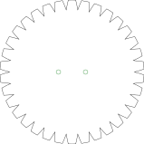

# Buzz disc

**[← All projects](https://gernreich.github.io/)**

**[Read the writeup](https://gernreich.github.io/buzz-disc/)**

**[Turn it in 3D](https://gernreich.github.io/buzz-disc/buzz-disc-3d.html)**

> **This is a dangerous object. It can injure you, and it can injure anyone
> near you.** Unlike a bullroarer this one spins close in — held between two
> hands, roughly at chest height, with your face above it. The toothed disc is
> about 38g in a single 3 mm thickness and 115g laminated three times,
> and its rim is a ring of points turning at speed. It can also come off the
> cord if a hole tears or a knot slips. Keep it clear of your face, check both
> holes and the loop before each session, and read
> [Handle it with care](#handle-it-with-care) first.

Two cut-ready designs for a buzz disc — a flat piece threaded on a cord loop that winds
and unwinds as you pull, spinning the disc back and forth. A toothed rim turns the whirr
into a buzz. Output is millimetre-true — `1 user unit = 1 mm` with a physical
`width`/`height` — so it prints and cuts at real size.

<table>
<tr>
<td align="center"><a href="BuzzDisc1.svg"></a></td>
<td align="center"><a href="BuzzDisc2.svg"></a></td>
</tr>
<tr>
<td align="center"><sub>Toothed disc · 159 × 160 mm</sub></td>
<td align="center"><sub>Plain bar · 150 × 40 mm</sub></td>
</tr>
</table>

*Click one to download its cut file. Each is at its own scale, so read the sizes rather
than the pictures. These are display renderings — the cut files draw a hairline on no
background, which a browser shows almost invisibly.*

Built for **[LaserMadeMusic](https://www.youtube.com/@LaserMadeMusic)**, where the
cutting and the spinning are shown.

**[The rest of the build files](https://gernreich.github.io/lasermademusic.html)** — every instrument,
generator and tool, indexed.

**[Download everything as a ZIP](https://github.com/Gernreich/buzz-disc/archive/refs/heads/main.zip)** — both designs.

## What is in each file

Drawn by `buzz_disc.rs` from each disc's parameters (by hand in Inkscape until
2026-11-08; the toothed rim is regular since, see Changing it):

| Design | Outline | Cord holes | Spacing |
|---|---|---|---|
| `BuzzDisc1.svg` | 159.4 × 159.5 mm, 34 teeth | two, 5 mm | 30 mm apart |
| `BuzzDisc2.svg` | 150.0 × 40.0 mm rectangle | two, 5 mm | 25 mm apart |

In both, the holes straddle the centre and sit on the centreline — that symmetry is what
lets the disc wind and unwind evenly instead of wobbling. Each file is cropped to the part
itself, so the sheet **is** the outline.

**Colour is the cut order**, and everything is a cut — there is no engrave layer. Run
**green first** for the two cord holes, while the part is still whole, then **black** for
the outline, which frees it. Give both an explicit operation; a per-colour job silently
skips any colour you leave unmapped.

The full sequence is shared by every LaserMadeMusic repository — blue engraves, then
green → orange → cyan → black, with black always the cut that frees the part. There is
no engrave layer here, so these two designs use only two of the four cut stages: green,
then black.

**The toothed disc is the buzzing one** — the teeth chopping the air are the sound. It is
also heavier, so it stores more energy and runs longer between pulls. **The plain bar**
has no teeth and far less area: quieter, faster to spin up, and the easier first cut.

## Before you cut

**Cut these in 3 mm Baltic birch plywood** — what they are built in. The cord holes are
where it fails, under real tension, so the void-free core of Baltic birch is worth the
difference over a cheaper sheet.

**Two or more laminations may sound better.** Cut the shape twice or three times and glue
the copies face to face: more mass at the same radius stores more energy per wind and runs
longer between pulls, and the teeth meet the air with a deeper edge. Line the cord holes up
when you glue.

**The cord is not in these files.** A continuous loop through both holes is the usual
arrangement; length and thickness are yours to settle by trying.

## Handle it with care

**This one spins close to you** — held between two hands at chest height, with your face
above it — and the lamination advice above deliberately makes it heavier.

- **Mass.** The toothed disc is about **38g** at one 3 mm thickness, **77g**
  laminated twice, **115g** three times.
- **Speed.** A wound cord releases fast, and the rim travels far quicker than the centre.
  The rim is where all the teeth are.
- **Shape.** The toothed rim is the whole point of the design and a ring of points at
  speed. It does not have to be sharp to catch skin.

Keep it **clear of your face**, and check both holes and the loop before each session —
especially on a laminated disc, where the glue line runs straight through them. The plain
bar has no teeth and far less area: it is the gentler one to learn the motion with.

## Checking the files

Both designs are gated by **`flat-part-check`** in
[lasermade-tools](https://github.com/Gernreich/lasermade-tools), which measures the
geometry rather than reading the drawing — millimetre-true units, bed fit, closed cuts,
the palette and its cut order, and the material left around every hole:

```sh
../lasermade-tools/target/release/flat-part-check --dir .
```

Both pass: **18 checks, 0 failed**, with 5 mm cord holes and 25.0 mm (disc) and 17.5 mm (bar)
of material between a hole and the nearest edge — no margin worth worrying about here, and
the glue line through the holes on a laminated disc matters more than the geometry does.
`.github/workflows/check.yml` runs the same command on every push.

The hand-drawn `BuzzDisc1.svg` (until 2026-11-08) taught the gate two of its own bugs:
its outline closed without a `z`, ends meeting to 0.00009 mm, and it started at 3 o'clock —
exactly the height of both cord holes, which is the degenerate case for a point-in-polygon
test. The generated rim closes with a `z` but still starts there. The tool's README tells
that story.

## Files

| | |
|---|---|
| `BuzzDisc1.svg` · `BuzzDisc2.svg` | the two cut-ready designs |
| `previews/` | display renderings — **not** cut files |
| `buzz-disc-3d.html` | the 3D view, assembled from the cut files — drag to turn |
| `buzz_disc.rs` | draws both cut files and writes the SolidCraft designs from each disc's parameters (Changing it, below) |
| `solidcraft/` · `step/` | the SolidCraft designs and the STEP files built from them |
| `viewer.rs` | builds `buzz-disc-3d.html` from the cut files, with the turn3d module in lasermade-tools: `cargo build --release`, then `target/release/viewer` |
| `Cargo.toml` · `Cargo.lock` | the Rust package for `buzz_disc.rs` and `viewer.rs`; it expects the lasermade-tools checkout beside this one |
| `.repro` | how every shipped drawing and page is reproduced |
| `index.md` · `index.html` | the published page; the markdown is the source |
| `.github/workflows/check.yml` | runs the pre-cut gate on every push |

Released under [CC0 1.0](LICENSE).

## Changing it

Each disc is a few numbers, and each is a flag on `buzz_disc.rs` (with `--disc=NAME`,
since each has its own; a dash for each underscore) and a parameter of the same name in
that disc's SolidCraft design:

```
cargo build --release
target/release/buzz_disc --disc=sawtooth-disc --teeth=28 --no-write
```

Without `--disc` it redraws both at their defaults. Each run prints the part's size and
mass a lamination, and a validation block: the cord holes either side of the centre, at
least 3 mm of ply between and around them, the outline, and the bed. `--out=DIR` writes
elsewhere; `--no-write` only checks.

**The toothed rim is regular since 2026-11-08.** The drawn rim was a polar wave: going
round, the radius rises linearly with the angle up a flank, holds at the tip along an arc
about the centre, and falls down the next flank, with no flat at the root. But it was
drawn by hand: 34 teeth whose tips and roots wandered ±0.6 mm round the turn, two tops
split in two, and a short flat where the drawing closed. Now every tooth is the same,
and the defaults are the drawn rim's averages: 34 teeth, tips 159.5 mm across, roots
138.2 mm, each flank 22% of a tooth's pitch (2.33°) and the tip the rest (5.94°).
In the cut file each flank is a cubic Bézier with the polar curve's own end tangents,
within a micrometre of it, and each top an arc.

**sawtooth-disc**

| parameter | default | what it is |
|---|---|---|
| `ply` | 3 mm | the ply: one lamination |
| `laminations` | 1 | discs glued face to face: the design's thickness is laminations × ply |
| `teeth` | 34 | teeth round the rim |
| `tip_d` | 159.5 mm | across the tips |
| `root_d` | 138.2 mm | across the roots |
| `flank` | 0.22 | each flank's share of a tooth's pitch; the tip has the rest |
| `hole_d` | 5 mm | a cord hole |
| `hole_gap` | 30 mm | cord hole centre to centre |

**plain-bar**

| parameter | default | what it is |
|---|---|---|
| `ply` | 3 mm | the ply: one lamination |
| `laminations` | 1 | discs glued face to face: the design's thickness is laminations × ply |
| `length` | 150 mm | the bar, end to end |
| `width` | 40 mm | the bar, across |
| `hole_d` | 5 mm | a cord hole |
| `hole_gap` | 25 mm | cord hole centre to centre |

## SolidCraft designs and STEP files

`solidcraft/buzz-disc-NAME.solidcraft.json` is each disc as a parametric SolidCraft
design, written by

```
target/release/buzz_disc --no-write --solidcraft=solidcraft
```

and SolidCraft builds each design file and STEP file from it:

```
cd solidcraft
solidcraft-cli run buzz-disc-sawtooth-disc.solidcraft.json --save buzz-disc-sawtooth-disc.sc --out ../step/buzz-disc-sawtooth-disc.step --quiet
../../lasermade-tools/target/release/sc-slim buzz-disc-sawtooth-disc.sc
```

Each is one body, `laminations` × `ply` thick. The toothed disc is the root disc with
one tooth joined to it, its flanks drawn from their formula, patterned round `teeth`
times, so the tooth count is a parameter like the rest. Built, each body's volume
matches the exact area the generator works out to within 3e-5, and with five or six
parameters moved at once (the disc at 28 teeth, 150 mm across, 30% flanks, two
laminations) the design builds what the generator draws at those values. `.repro`
checks all six files. The STEP files used to be written from the 3D view by
`step-export`; since 2026-11-08 SolidCraft builds them.

The files:

- `solidcraft/buzz-disc-sawtooth-disc.solidcraft.json` · `solidcraft/buzz-disc-sawtooth-disc.sc` · `step/buzz-disc-sawtooth-disc.step`
- `solidcraft/buzz-disc-plain-bar.solidcraft.json` · `solidcraft/buzz-disc-plain-bar.sc` · `step/buzz-disc-plain-bar.step`

## Credits

Made by Michael Gernreich with [Claude](https://www.anthropic.com/claude) (Anthropic), working in Claude Code, which co-wrote the code and the documentation. Commits Claude made carry a `Co-Authored-By: Claude` line.
