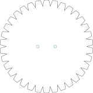

# Buzz disc — two designs

**[← All projects](https://gernreich.github.io/)**

**[Read the README](https://github.com/Gernreich/buzz-disc)**

**[Turn it in 3D](https://gernreich.github.io/buzz-disc/buzz-disc-3d.html)**

<iframe src="buzz-disc-3d.html?embed" title="The buzz discs as solid parts you can drag to turn, each its cut file's own outline stood on edge with the cord loop through its centre holes, with a button for each disc and a box to spin it" style="width:100%;height:560px;border:0"></iframe>

> **This is a dangerous object. It can injure you, and it can injure anyone
> near you.** Unlike a bullroarer this one spins close in — held between two
> hands, roughly at chest height, with your face above it. The toothed disc is
> about 38g in a single 3 mm thickness and 115g laminated three times,
> and its rim is a ring of points turning at speed. It can also come off the
> cord if a hole tears or a knot slips. Keep it clear of your face, check both
> holes and the loop before each session, and read
> [Handle it with care](#handle-it-with-care) first.

A buzz disc is a flat piece threaded on a loop of cord that passes through two holes
near its centre. Wind the loop up by swinging the disc, then pull and release the ends
rhythmically: the cord unwinds, spins the disc, winds up the other way, and the disc
whirrs back and forth. A toothed rim turns that whirr into a buzz.

Two designs, both cut-ready, both with a pair of 5 mm cord holes.

## Get the files

- **[Everything as a ZIP](https://github.com/Gernreich/buzz-disc/archive/refs/heads/main.zip)**
  — both designs.
- **[Repository](https://github.com/Gernreich/buzz-disc)** — if you want to change the
  outline or the hole spacing.
- Or click either picture below to download that one cut file.

Released under CC0 1.0 — do what you like with them, no attribution needed. Built for
**[LaserMadeMusic](https://www.youtube.com/@LaserMadeMusic)**.

**[The rest of the build files](https://gernreich.github.io/lasermademusic.html)** — every instrument,
generator and tool, indexed.

## The two designs

Click either to download the cut file. The pictures are display renderings — the cut
files draw a hairline on no background at all, which a browser shows almost invisibly,
so these are thickened and painted onto a light ground and cropped to the part. Green, orange and cyan are darkened in the picture — at full strength they are too pale to read against a light ground. The cut file keeps the exact values. **Each is at its own scale**; read the sizes rather than the pictures.

<div class="tw">
<table>
<tr>
<td align="center"><a href="BuzzDisc1.svg"></a></td>
<td align="center"><a href="BuzzDisc2.svg"></a></td>
</tr>
<tr>
<td align="center"><sub>Toothed disc · 159 × 160 mm</sub></td>
<td align="center"><sub>Plain bar · 150 × 40 mm</sub></td>
</tr>
</table>
</div>

## What the files contain

Drawn by `buzz_disc.rs` from each disc's parameters (by hand in Inkscape until
2026-11-08; the toothed rim is regular since, see Changing it):

| Design | Outline | Cord holes | Spacing, centre to centre |
|---|---|---|---|
| `BuzzDisc1.svg` | 159.4 × 159.5 mm, 34 teeth | two, 5 mm | 30 mm |
| `BuzzDisc2.svg` | 150.0 × 40.0 mm rectangle | two, 5 mm | 25 mm |

**In both, the pair of holes straddles the centre and sits on the centreline** — 15 mm
and 12.5 mm either side of it respectively. That symmetry is what lets the disc wind and
unwind evenly instead of wobbling.

Each file is cropped to the part itself, so the sheet **is** the outline — 159.4 × 159.5 mm
for the disc, 150 × 40 mm for the bar. Output is millimetre-true — `1 user unit = 1 mm`
with a physical `width`/`height` — so it prints and cuts at real size.

### Colour is the cut order

**Colour is the cut order, and it is the same in every LaserMadeMusic repository: blue engraves, then green → orange → cyan → black.** Black is always the last cut, the one that frees the part; violet means skip and is never cut. A file uses only the stages it needs. There is no engrave layer here, and only two of
the four cut stages are used.

| | Colour | What | Why then |
|---|---|---|---|
| 1 | **green `#00ff00`** | the two cord holes | while the part is still whole |
| 2 | **black `#000000`** | the outline | frees the part, so it goes last |

Give both an explicit operation. A per-colour job silently skips any colour you leave
unmapped — leave green out and you get a disc with nothing to thread.

## What the two designs do differently

The **toothed disc** is the buzzing one. Its rim is cut into triangular teeth, and those
teeth chopping the air are what turn a quiet whirr into the sound the instrument is
named for. It is also the larger and heavier of the two, which means more stored energy
and a longer run between pulls.

The **plain bar** has no teeth and a much smaller area. Expect it to be quieter and
faster to spin up — closer to a whirring button than a buzzer. It is the simpler cut,
and the better first one to try.

## Before you cut

**Cut these in 3 mm Baltic birch plywood** — that is what they are built in. The disc is
under real tension in use and the cord holes are where it fails: a ply that delaminates
gives way there first, which is why Baltic birch and its void-free core is worth the
difference over a cheaper sheet.

**Two or more laminations may sound better.** Cut the same shape twice or three times and
glue the copies face to face. A thicker disc carries more mass at the same radius, so it
stores more energy per wind and runs longer between pulls — and the teeth present a
deeper edge to the air. Worth trying before you decide the single-thickness version is
what it sounds like. Line the cord holes up when you glue: they are what the whole thing
turns on.

**The cord is not in these files.** A continuous loop through both holes is the usual
arrangement; length and thickness are yours to settle by trying.

## Handle it with care

**Unlike a bullroarer, this one spins close to you** — held between two hands, roughly at
chest height, with your face above it. Mass, speed and shape all matter, and the
lamination advice above makes the first of them worse on purpose.

**Mass.** The toothed disc is about **38g** in a single 3 mm thickness, **77g**
laminated twice and **115g** three times (Baltic birch near 680 kg/m³). That is a meaningful weight spinning a hand's
width from your fingers.

**Speed.** A wound cord releases quickly, and the rim of a 160 mm disc travels far faster
than its centre. That rim is where all the teeth are.

**Shape.** The toothed rim is the whole point of the design — it is what makes the buzz —
and it is a ring of points turning at speed. It does not have to be sharp to catch skin.

So: **keep it clear of your face**, and be aware the disc can come off the cord if a hole
tears or a knot slips. Check both holes and the loop before each session, especially on a
laminated disc where the glue line runs right through them. The plain bar has no teeth and
far less area — it is the gentler one to learn the motion with.

## Files

| | |
|---|---|
| `BuzzDisc1.svg` · `BuzzDisc2.svg` | the two cut-ready designs |
| `previews/` | display renderings — **not** cut files |
| `buzz-disc-3d.html` | the 3D view, assembled from the cut files — drag to turn |
| `buzz_disc.rs` | draws both cut files and writes the SolidCraft designs from each disc's parameters (Changing it, below) |
| `solidcraft/` · `step/` | the SolidCraft designs and the STEP files built from them |
| `viewer.rs` | builds `buzz-disc-3d.html` from the cut files, with the turn3d module in lasermade-tools: `cargo build --release`, then `target/release/viewer` |
| `Cargo.toml` · `Cargo.lock` | the Rust package for `buzz_disc.rs` and `viewer.rs`; it expects the lasermade-tools checkout beside this one |
| `.repro` | how every shipped drawing and page is reproduced |
| `index.md` · `index.html` | this page; the markdown is the source |

## Changing it

Each disc is a few numbers, and each is a flag on `buzz_disc.rs` (with `--disc=NAME`,
since each has its own; a dash for each underscore) and a parameter of the same name in
that disc's SolidCraft design:

```
cargo build --release
target/release/buzz_disc --disc=sawtooth-disc --teeth=28 --no-write
```

Without `--disc` it redraws both at their defaults. Each run prints the part's size and
mass a lamination, and a validation block: the cord holes either side of the centre, at
least 3 mm of ply between and around them, the outline, and the bed. `--out=DIR` writes
elsewhere; `--no-write` only checks.

**The toothed rim is regular since 2026-11-08.** The drawn rim was a polar wave: going
round, the radius rises linearly with the angle up a flank, holds at the tip along an arc
about the centre, and falls down the next flank, with no flat at the root. But it was
drawn by hand: 34 teeth whose tips and roots wandered ±0.6 mm round the turn, two tops
split in two, and a short flat where the drawing closed. Now every tooth is the same,
and the defaults are the drawn rim's averages: 34 teeth, tips 159.5 mm across, roots
138.2 mm, each flank 22% of a tooth's pitch (2.33°) and the tip the rest (5.94°).
In the cut file each flank is a cubic Bézier with the polar curve's own end tangents,
within a micrometre of it, and each top an arc.

**sawtooth-disc**

| parameter | default | what it is |
|---|---|---|
| `ply` | 3 mm | the ply: one lamination |
| `laminations` | 1 | discs glued face to face: the design's thickness is laminations × ply |
| `teeth` | 34 | teeth round the rim |
| `tip_d` | 159.5 mm | across the tips |
| `root_d` | 138.2 mm | across the roots |
| `flank` | 0.22 | each flank's share of a tooth's pitch; the tip has the rest |
| `hole_d` | 5 mm | a cord hole |
| `hole_gap` | 30 mm | cord hole centre to centre |

**plain-bar**

| parameter | default | what it is |
|---|---|---|
| `ply` | 3 mm | the ply: one lamination |
| `laminations` | 1 | discs glued face to face: the design's thickness is laminations × ply |
| `length` | 150 mm | the bar, end to end |
| `width` | 40 mm | the bar, across |
| `hole_d` | 5 mm | a cord hole |
| `hole_gap` | 25 mm | cord hole centre to centre |

## SolidCraft designs and STEP files

`solidcraft/buzz-disc-NAME.solidcraft.json` is each disc as a parametric SolidCraft
design, written by

```
target/release/buzz_disc --no-write --solidcraft=solidcraft
```

and SolidCraft builds each design file and STEP file from it:

```
cd solidcraft
solidcraft-cli run buzz-disc-sawtooth-disc.solidcraft.json --save buzz-disc-sawtooth-disc.sc --out ../step/buzz-disc-sawtooth-disc.step --quiet
../../lasermade-tools/target/release/sc-slim buzz-disc-sawtooth-disc.sc
```

Each is one body, `laminations` × `ply` thick. The toothed disc is the root disc with
one tooth joined to it, its flanks drawn from their formula, patterned round `teeth`
times, so the tooth count is a parameter like the rest. Built, each body's volume
matches the exact area the generator works out to within 3e-5, and with five or six
parameters moved at once (the disc at 28 teeth, 150 mm across, 30% flanks, two
laminations) the design builds what the generator draws at those values. `.repro`
checks all six files. The STEP files used to be written from the 3D view by
`step-export`; since 2026-11-08 SolidCraft builds them.

The files:

- `solidcraft/buzz-disc-sawtooth-disc.solidcraft.json` · `solidcraft/buzz-disc-sawtooth-disc.sc` · `step/buzz-disc-sawtooth-disc.step`
- `solidcraft/buzz-disc-plain-bar.solidcraft.json` · `solidcraft/buzz-disc-plain-bar.sc` · `step/buzz-disc-plain-bar.step`

## Credits

Made by Michael Gernreich with [Claude](https://www.anthropic.com/claude) (Anthropic), working in Claude Code, which co-wrote the code and the documentation. Commits Claude made carry a `Co-Authored-By: Claude` line.
